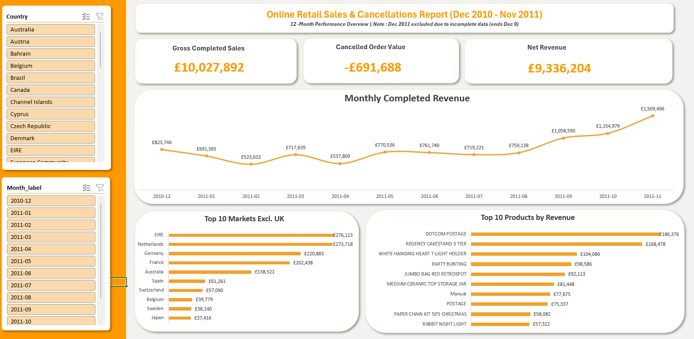

# Online Retail Sales & Cancellations Report (Excel & Power Query)

## Project Overview
*Business scenario (hypothetical):* A UK-based online gift retailer needed a 12-month performance overview to track monthly sales trends, compare top international markets outside the UK, identify core revenue-driving products, and quantify how much sales value is reversed by cancelled orders.

* *Reporting Period:* December 2010 – November 2011 (December 2011 is excluded because records end on 9 December, which would distort monthly trend comparisons).
* *Currency:* British Pounds (£)
* *Tools Used:* Microsoft Excel, Power Query, Excel Data Model, PivotTables, PivotCharts, Interactive Slicers.

---

## Key Findings
1. *Clear Autumn Peak Across Key Markets:* Revenue peaked in *November 2011 (£1.5M)—nearly **3x higher* than the *February 2011 low (£523K)* (a 65.1% swing). The UK, EIRE, and the Netherlands all follow this exact same late-year surge, meaning international demand reinforces rather than offsets the Q1 slowdown.
2. *Cancellations Equal 6.9% of Gross Sales:* Cancelled invoices totaled *£691,688* against *£10.03M* in gross completed sales, reducing net revenue to *£9.34M*.
3. *Overlapping Core Products:* The same physical products rank near the top across the UK, EIRE, and the Netherlands (including *[Insert Your Top Product 1], *[Insert Your Top Product 2]*, and *[Insert Your Top Product 3]**). This confirms strong cross-border appeal rather than isolated domestic demand, though it also concentrates stock risk on these core SKUs during peak months.

> Note: This analysis covers a single 12-month window, so seasonal patterns cannot be separated from year-over-year business growth (see Limitations).

---

## Business Recommendations
* *Smooth Out Seasonal Swings:* Run targeted promotions and clearance campaigns in early Q1 (*February–March) to lift off-peak sales, while securing supplier stock and shipping capacity ahead of the **September–November* surge.
* *Investigate Cancellations:* Break down the £691.7K in cancelled orders by SKU and customer account to fix recurring fulfillment, stockout, or order-entry errors.
* *Protect Core Stock & Expand Secondary Markets:* Hold buffer inventory on overlapping top products before autumn to prevent cross-market stockouts, and use these proven bestsellers as lead items to grow sales in secondary European markets (such as Germany and France).

---

